# 酒馆战棋 · 模拟器 (BGSIM)

一个可玩的、尽量还原《炉石传说：酒馆战棋》的模拟器，支持单机对抗 AI 与**八人联机**。界面用 **React 19 + Vite + TypeScript** 重写，
规则使用 **taverngym** 引擎（Rust 编译的完整八人战棋实现），因此不是简化版沙盒：完整的卡池、英雄技能、
酒馆法术、任务、饰品、畸变、三连奖励、8 人配对与淘汰都由引擎结算。

> 非官方粉丝项目，与暴雪娱乐无关。卡图与英雄头像来自社区 CDN（art.hearthstonejson.com），
> 卡框/星级/种族图标取自 HBT 图鉴项目。请自行确认素材使用权限。

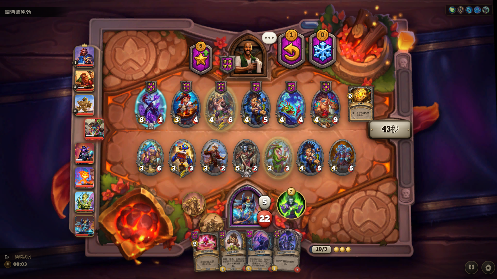

## 首页 / 模式

打开就是一个统一首页，右侧三条列表：

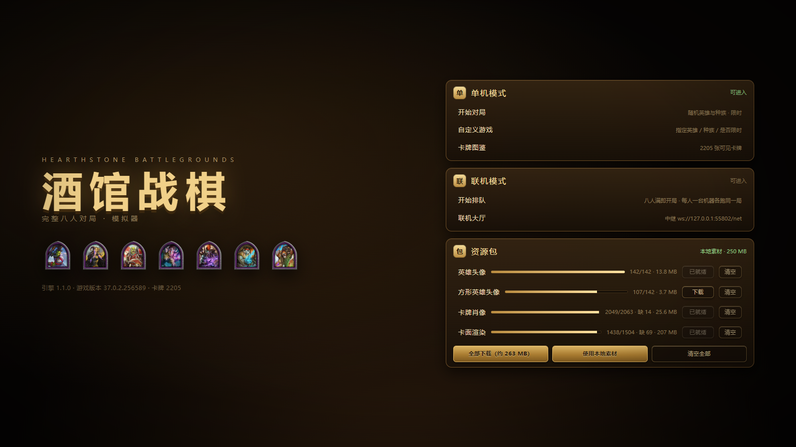

| 列表 | 状态 | 说明 |
| --- | --- | --- |
| **单机模式** | 可玩 | 继续对局 / 新对局 / 卡牌图鉴；点整张卡片或「继续对局」回到牌桌 |
| **联机模式** | 可玩 | 八人排队，满员开局（每台机器各跑一份完整引擎，中继只排队和给动作排序）；人不够时用电脑补位 |
| **资源包** | 可下载 | 把游戏会用到的美术一次性下到本地（约 260 MB），之后不再等图 |

对局是存在引擎进程里的，所以顶栏的「首页」只是切页面，随时可以回来接着打（首页会显示「进行中 · 第 N 回合」）。想跳过首页直接进牌桌，用 `?mode=single`；直接去联机大厅用 `?mode=net`（`&bot=1` 是托管/自动打）。

### 资源包（本地美术素材）

默认所有美术都从 `art.hearthstonejson.com` 按需加载。在首页「资源包」里点「全部下载」，引擎会把它们缓存到
`data/assets/<kind>/<id>.<ext>`，之后前端改成请求自己的 `/art/<kind>/<id>`——命中缓存直接给文件，
没命中就临时去 CDN 取一次并存下来，所以随时切换都不会出现裂图。下载是 8 线程并发的，全量约 3–5 分钟。

| 种类 | 内容 | 数量 | 体积 |
| --- | --- | --- | --- |
| `hero` 英雄头像 | 256px png | 142 | ≈ 14 MB |
| `portrait` 卡牌肖像 | 256px jpg（含金卡） | 2063 | ≈ 28 MB |
| `render` 卡面渲染 | 256px png（只收基础卡） | 1504 | ≈ 220 MB |

两个取舍让它停在 **约 260 MB** 而不是 1 GB：

- **用 256px 的卡面渲染，不用 512px**。卡面在界面上是 168×200 CSS px，2x 屏也就 336×400 物理像素，256px 的原图够用；512px 单张要 465 KB，256px 只要 149 KB（省 68%）。
- **只下基础卡，不下金卡变体**。金卡是同一张图加 CSS 镀金（`RenderCard` 本来就优先取 `baseId`），1109 个 `_G` 副本白白多占 165 MB。肖像只有 14 KB，所以金卡的肖像照下（看起来更好）。

缓存目录在 `data/` 下（已被 .gitignore），每行右侧可以单独「清空」，「清空全部」会删掉所有文件并把开关切回 CDN。

## 联机模式

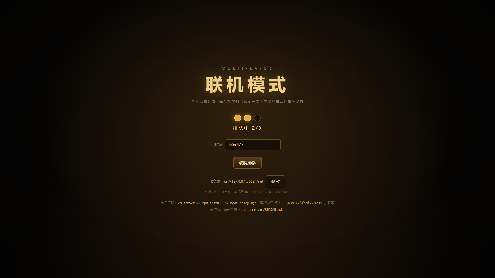

**客户端和服务端是两个独立产物**，各自构建、各自部署、各自升级：

```
玩家电脑（Tauri 客户端，安装包自带引擎）        你的 VPS（联机服务端）
┌────────────────────────────────────┐        ┌───────────────────────────┐
│ React UI  ←同源 HTTP→  本机 Python 引擎 │        │  server/relay.mjs         │
│                        （完整八人模拟）│◄──ws──►│  只做：排队/编号/广播/超时 │
│  dist/ + engine/ 都打在安装包里      │        │  无引擎、无状态、无数据库  │
└────────────────────────────────────┘        └───────────────────────────┘
```

八个人各开一份游戏，**每台机器都跑完整的八人引擎**；服务端只做三件事：排队凑人、给每个动作盖一个全局递增的
`seq`、把这条动作流原样广播给八个人。所有人按同一个 `seq` 顺序落子，八份引擎因此逐字节一致
（`node scripts/lockstep-test.mjs` 就是证明这件事的）。

**服务端**（部署在 VPS 上，见 [server/README.md](server/README.md)）：

```bash
cd server && npm install
node relay.mjs                      # 本机试：ws://127.0.0.1:8790/net
HOST=0.0.0.0 PORT=8790 node relay.mjs   # 直接对外（套 nginx/Caddy 拿 wss 更好）
docker compose up -d                # 或者用自带 Dockerfile
```

**客户端**要知道服务器在哪，三种方式（后者优先级更高）：

| 方式 | 用法 |
| --- | --- |
| 打包内置 | 构建时 `VITE_RELAY_URL=wss://bg.example.com/net npm run desktop` |
| 游戏里改 | 联机大厅 →「修改」，存在本机，换服务器不用重装 |
| 临时指定 | `?relay=wss://bg.example.com/net`（局域网 `ws://192.168.1.20:8790/net`） |

开发时 `npm run start` 会顺手在 8790 起一份本地服务端（就是 `server/relay.mjs`），vite 把 `/net` 代理过去。

- 首页「联机模式 → 开始排队」，满 `--need` 人（默认 8）自动开局；不满的人由引擎自带的 AI 补位。
- 开局后就是普通牌桌：左边一排小灯是八个座位（金色=你，绿色=玩家，蓝色=电脑，熄灭=掉线），
  顶栏显示「座位 N · 昵称」，结束回合按钮在别人还没结束时变成进度条。
- 回合时钟由**服务端**掌管：客户端只显示，时间到由服务端代所有人 `结束回合`，同样走 `seq` 流。
- 掉线/刷新页面不用重开：座位保留，重连后服务端把这局的动作日志发回来，本机引擎原地重放（几百个动作几十毫秒）。
- 挂机可以点「托管」，让引擎替你操作（`?bot=1` 也是这个开关，群里凑不齐人时用来凑数）。
- 「离开」会放弃这个座位（本回合内由超时机制收尾），回到首页后单机那局还在。

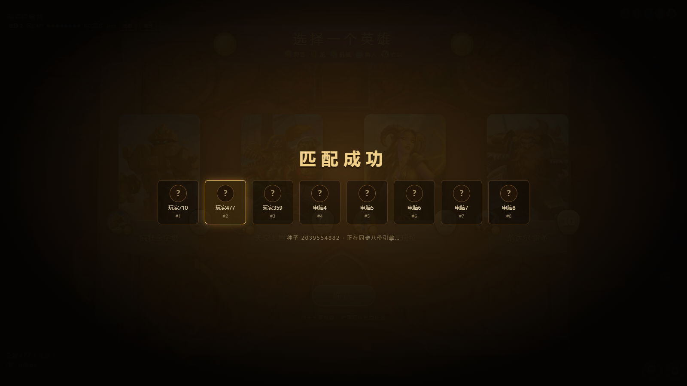

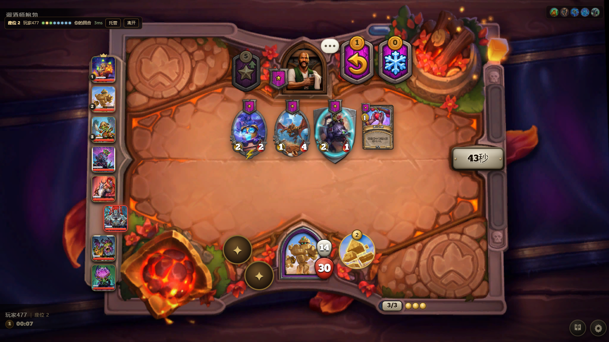

**版本必须一致**：八个人要在同一份确定性引擎上跑，所以服务端按「引擎构建」给排队分桶——不同版本的客户端
永远不会被凑到一桌，大厅里会直接告诉你「另有 N 人在别的版本上排队」。协议版本不匹配则连不上并提示升级。

**信任模型**：现在这套是「客户端全量模拟」——改客户端就能看全图、改数值，朋友局足够，但它不是竞技级反作弊。
要真正公平得服务端跑引擎、只下发 `view(seat)`，那是另一套架构，接口（`/api/net/*`）和协议都为它留了位置，v1 不做。

## 快速开始

环境要求：Windows x64、Node.js ≥ 20，以及一份装有 **taverngym** 的 Python 3.10 运行时（见下节）。

```powershell
npm install          # 客户端依赖
npm run relay:install # 想在本机跑联机服务端才需要（只装 ws）
npm run start        # 引擎(:8787) + 开发服务器(:5173) + 本地中继(:8790)
```

### 引擎运行时

规则引擎 `taverngym` 是编译好的 Rust 扩展（Windows x64 / Python 3.10），**不随源码仓库分发**（体积和上游许可都不适合进 git）。二选一：

1. **用打包好的运行时**：把 `python.exe` + `Lib/site-packages`（含 `taverngym`、`numpy`）放到 `engine/runtime/`，`npm run start` 会自动用它；
2. **用你自己的 Python**：装 Python 3.10 x64 和引擎（例如从 [AutoTavern](https://github.com/MCG-NJU/AutoTavern) 构建 `taverngym` wheel），然后

   ```powershell
   $env:BGSIM_PYTHON='C:\Python310\python.exe'
   npm run start
   ```

`node scripts/server.mjs` 会优先用 `BGSIM_PYTHON`，没有才回落到 `engine/runtime`。跑 `GET /api/health` 能看到引擎版本就说明接上了。

或者分开启动：

```powershell
npm run server       # 只启动引擎桥（生产模式会同时托管 dist/）
npm run relay        # 只启动联机服务端（server/relay.mjs）
npm run dev          # 前端开发服务器，/api 自动代理到 :8787，/net 代理到 :8790
```

打包静态站点：

```powershell
npm run build        # 输出 dist/
npm run server       # http://127.0.0.1:8787 直接玩打包版
```

想在**不打扰当前对局**的前提下跑回归测试，可以起一个独立的测试引擎：

```powershell
node scripts/server.mjs --port 8799
$env:BGSIM_ENGINE='http://127.0.0.1:8799'; $env:BGSIM_PORT='5174'; npx vite
node scripts/feel-test.mjs     # 拖拽/购买/出售/法术/队列/战斗 共 117 项
```

联机有自己的五套测试，全部用临时端口和临时目录，**不会碰 8787 上正在玩的局**：

```powershell
npm run relay:install            # 服务端依赖（只有 ws；客户端包里没有它）
node scripts/lockstep-test.mjs   # 两个引擎同 seed、同动作序，每回合比对 state 摘要（必过）
node scripts/engine-slots-test.mjs # 一个引擎开两个标签页：各守自己的座位
node scripts/relay-test.mjs      # 服务端协议：排队/seq/超时代发/重连/对账/版本分桶/token
npm run build                    # 下面三个用构建产物，每个玩家一个引擎
node scripts/net-e2e.mjs         # 8 个浏览器 + 8 个引擎跑完整一局，中途刷新一个人
node scripts/net-ui-test.mjs     # 真·人类路径：排队→匹配→选英雄→拖拽买牌→结束回合→下一回合
node scripts/net-shots.mjs       # 重新生成 docs/screens/net-*.png
```

`npm run test:net` 会把前五套依次跑一遍。

## 操作

| 操作 | 说明 |
| --- | --- |
| 点击酒馆卡牌 | 购买（随从进手牌，法术进手牌） |
| 点击手牌 | 打出到阵容末尾 |
| 拖拽手牌到战场 | 打出到指针所在位置（卡牌之间会插入到对应位置，右侧随从会让位） |
| 拖拽手牌中的法术到随从/酒馆随从 | 直接对合法目标施放；目标不合法时保留目标选择状态 |
| 拖拽酒馆卡牌到手牌或战场 | 购买（放到战场也只是买入，不会自动上场） |
| 拖拽磁力随从到机械左侧 | 自动吸附到那只机械上（真实规则：落点右侧是机械就吸附；满场也能吸附） |
| 拖拽战场随从 | 调整站位（左→右即攻击顺序） |
| 拖拽战场随从到酒馆区域 | 出售，返还 1 枚铸币 |
| 右键战场随从 | 出售，返还 1 枚铸币 |
| 拖拽中按 `Esc` / 右键 | 取消拖拽（卡牌弹回原位） |
| 指向性英雄技能 | 按住技能拉出弧线，拖到目标上松手施放；松在空处或按 `Esc` 取消 |
| 指向性手牌法术 | 同样：按住法术牌拖到目标上松手（血宝石、圣盾、+属性这类） |
| 悬停手牌 | 放大抬起，方便看清 |
| 刷新 / 冻结 / 升级 | 右上角按钮，或 `R` / `F` / `E` |
| 结束回合 | 右下角按钮或空格 |
| 打出手牌 | 点击，或按 `1`–`9` |
| 撤销 | 顶栏按钮或 `Ctrl+Z` |
| 图鉴 | 顶栏「图鉴」，按星级/种族/名称筛选 |
| 菜单 | 顶栏「☰」：重新开局、音效、保存/读取、图鉴 |
| 返回首页 | 顶栏「首页」，或菜单里的「返回首页」；对局保留在引擎里，首页点「继续对局」接着打 |

拖拽使用 Pointer Events 实现（不是原生 HTML5 drag & drop），因此拖拽影像逐帧跟随指针、
支持触屏与手写笔，落点非法时会回弹并提示。

英雄技能在左侧英雄头像下方；发现、三连奖励、饰品、任务、时空扭曲等选择会以弹窗出现。

## 特性

- **完整对局**：8 名玩家（你 + 7 个脚本 AI），招募 → 战斗 → 伤害 → 淘汰 → 名次结算。
- **联机八人局**：同一份引擎跑在每个人的机器上，中继只排序动作；确定性由 `lockstep-test` 守住，
  断线可重连、掉线可托管、超时由中继代发结束回合、每回合互报状态摘要查不同步。
- **完整内容**：引擎覆盖当前版本卡池（37.0.2，2205 张可见卡牌），包含英雄技能、酒馆法术、任务与奖励、大小饰品、
  畸变/神明、黑暗馈赠、时空扭曲酒馆、伙伴等。
- **战斗回放**：引擎逐帧记录战斗（攻击、死亡、召唤、Buff），前端按帧播放并显示浮动伤害与战斗播报。
- **信息面板**：左侧是实时血甲排行（血量+护甲降序，战斗后自动重排，淘汰者沉底、第 8 名在最下），
  悬停可看对手上次阵容、血量/护甲/等级、连胜、任务进度、饰品、战斗日志（中文）。
- **性能**：单个操作一次引擎调用（通常 5ms 左右），视图经过裁剪与 gzip，不再像旧沙盒那样每次落盘。
- **中文界面**：卡牌名称/描述来自引擎中文数据；卡图与英雄头像按需从 CDN 加载。
- **音效与存档**：合成音效（可关闭）、手动保存/读取、撤销最近 12 步。

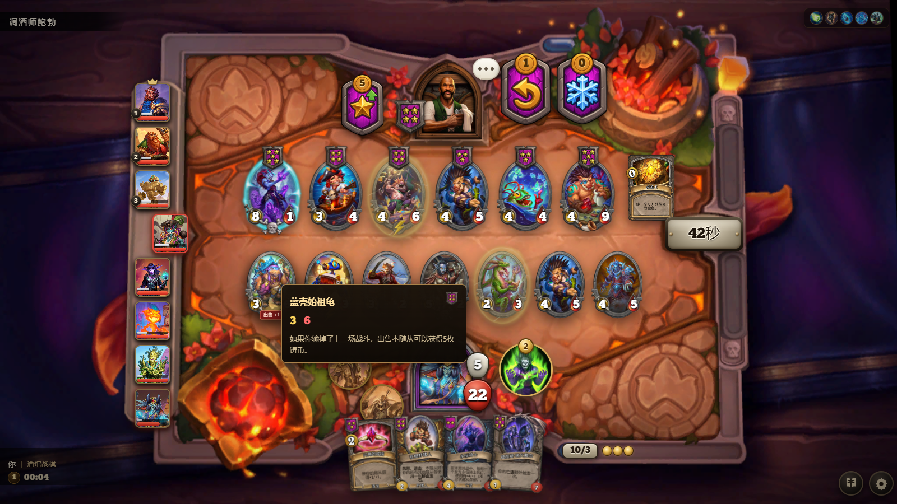

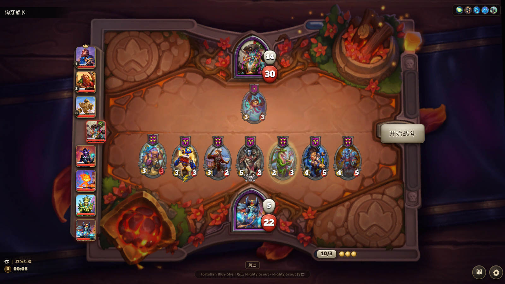

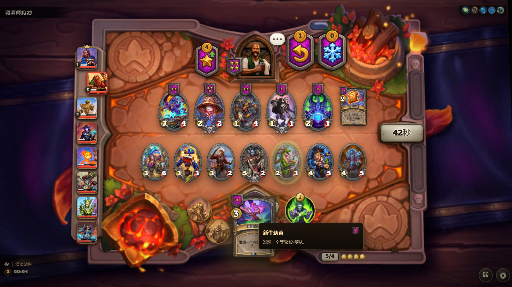

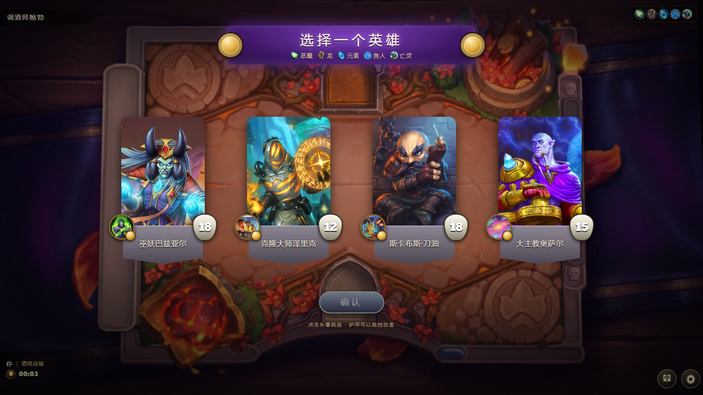

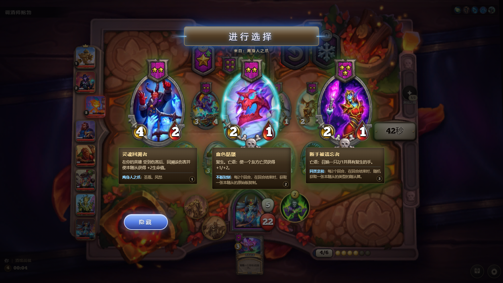

## 架构

```
engine/
  server.py            # HTTP 桥：紧凑视图、动作、战斗回放、调试命令、联机座位
  runtime/             # 随附的 Python 3.10 + numpy + taverngym（Rust 扩展）
server/                # ★ 联机服务端（独立产物，只有 ws 一个依赖）
  relay.mjs            #   排队/编号/广播/超时/重连/对账/版本分桶
  Dockerfile compose.yaml bgsim-relay.service README.md
src/
  api.ts               # /api 客户端（单机 + 联机座位）
  store.ts             # zustand 全局状态（视图、战斗、提示、当前模式）
  store/net.ts         # 联机客户端：连接、动作流、seq 对齐、重连重建、托管
  components/          # 酒馆、卡牌、战斗、弹窗、图鉴、联机大厅/HUD/结算
  lib/                 # 资源 URL、关键词、文本、日志翻译、动作辅助
  styles.css           # 场景/卡牌/战斗/联机视觉
scripts/
  server.mjs           # 用随附解释器启动引擎
  start.mjs            # 一键启动引擎 + Vite + 本地中继
  feel-test.mjs        # 单机回归（117 条）
  lockstep-test.mjs    # 双引擎确定性测试
  relay-test.mjs       # 服务端协议测试
  net-e2e.mjs          # 八浏览器整局测试
public/img/            # 卡框、星级、种族图标（来自 HBT card-browser 分支）
```

### 接口

| 端点 | 说明 |
| --- | --- |
| `GET /api/state` | 当前玩家视图（紧凑 JSON） |
| `POST /api/new` | 新对局 `{seed?}` |
| `POST /api/action` | 执行动作 `{action}`（0 结束回合、1 刷新、2 冻结、3 升级、4/5 英雄技能、8+ 购买…） |
| `POST /api/choose` | 处理待选 `{option}` |
| `POST /api/hero` | 选择英雄 `{id}` |
| `POST /api/undo` | 撤销 |
| `POST /api/finish` | 淘汰后快进到结算 |
| `GET /api/catalog` | 卡牌图鉴数据（含中文名/描述/星级/种族） |
| `POST /api/debug` | 沙盒调试（设置金币/生命/等级、加牌等） |
| `GET /api/assets` | 本地美术包状态（每种的总数/已下载/字节数/是否在下载） |
| `POST /api/assets/download` | 开始下载 `{kinds?: ["hero","portrait","render"]}`（后台线程） |
| `POST /api/assets/enabled` | `{enabled}` 切换前端用 CDN 还是本地 `/art` |
| `POST /api/assets/clear` | 清空本地素材缓存 |
| `GET /art/<kind>/<id>` | 本地素材（命中缓存即回文件，否则取一次 CDN 并存下来） |
| `POST /api/net/new` | 联机开一局：`{seed, seat, config?, replay?}`（`replay` 用于刷新/重连后重建） |
| `POST /api/net/steps` | 按中继给的顺序落子：`{steps:[[seat,action],…]}`，返回还需要谁动作、回合摘要 |
| `GET /api/net/state` | 本座位的完整视图（`?combats=1` 带战斗回放） |
| `GET /api/net/status` | 廉价状态：回合、八个座位是否待动作、是否结束 |
| `GET /api/net/hash` | `state_json()` 的 sha256（对账用） |
| `GET /api/net/bot?seat=k` | 让引擎替某个座位算一个合法动作（补位/托管） |

中继只有一个 WebSocket 端点 `ws://<host>:8790/net`（生产用 `wss://域名/net`），消息全是 JSON，`t` 是类型：

| 方向 | 消息 |
| --- | --- |
| C→R | `hello`（协议 + 引擎构建 + 昵称）`queue` `leave` `meta`(END 的编号) `turn`(回合+时长) `act` `hash` `over` `resume` `ping` |
| R→C | `welcome` `incompatible` `queue` `start` `act`(带 seq) `deadline` `progress` `peer` `captain` `desync` `sync` `over` `left` `gone` `replaced` `pong` |

服务端另有两个给运维用的 HTTP 端点：`GET /healthz`（纯文本 ok）和 `GET /net/health`（JSON：协议版本、排队、
房间进度、是否 desync、累计统计）。部署、TLS、systemd/Docker、容量与安全见 [server/README.md](server/README.md)。

`GET /net/health` 返回排队人数、活跃房间和每个房间的进度（排障用）。

动作编号与 taverngym 的 245 维动作空间一致，前端通过 `view.actions` 里的基址计算。

## 已知限制

- 联机是**客户端全量模拟**：朋友局够用，但不防改客户端（见「联机模式」里的信任模型）。
- 联机只有排队匹配：没有私密房间/观战/回放分享；服务端是内存态，重启就散场（进行中的对局会断）。
- 客户端与服务端必须版本一致才可能同桌；升级客户端时旧版本玩家只能另开一桌。
- 战斗动画是「按帧近似」而非逐事件回放，极少数连锁（大量亡语/召唤）可能显得跳跃。
- 卡图来自 CDN，首次加载某张卡时可能短暂空白；离线时只有卡框与文字。
- 引擎版本固定为随附的 37.0.2 构建，更新卡池需要替换 `engine/runtime` 中的 taverngym（见下）。

## 致谢

- [AutoTavern](https://github.com/MCG-NJU/AutoTavern) —— 规则引擎 `taverngym` 的上游项目，完整的八人战棋模拟与卡牌数据都来自这里。
- HearthstoneBattlegroundTracker 的 `card-browser` 分支 —— 卡框、星级盾徽与种族图标。
- 卡图与英雄头像来自社区 CDN `art.hearthstonejson.com`。

## 许可

代码：**MIT**（见 [LICENSE](LICENSE)）。引擎 taverngym 及其数据遵循 AutoTavern 项目许可（见 [NOTICE](NOTICE) 与上游仓库）。
卡牌图像、名称与描述版权归暴雪娱乐所有，本项目仅用于本地学习与研究。

## 参与开发

欢迎 PR。环境搭建、目录结构、测试矩阵和提交约定见 [CONTRIBUTING.md](CONTRIBUTING.md)。

机制会随版本轮换（饰品、黑暗之赐、畸变、时空扭曲……）。项目用 **规则集 profile + 能力开关**
管理这件事：换版本只关开关、不删代码 —— 详见 [docs/RULESETS.md](docs/RULESETS.md)。

## UI 调整器

牌桌使用 `public/img/ui/board-darkwood.png` 作为空桌面底图，所有元素（鲍勃、酒馆等级、刷新/冻结、商店、战场、手牌、英雄、技能、金币、升级、饰品栏、结束回合）都是可独立移动/缩放的盒子。

打开方式：

- 浏览器访问 `http://127.0.0.1:8787/?edit=1`
- 或游戏内菜单 → 「UI 调整器（拖拽排版）」

使用：

1. 点「生成演示局面」载入一局 7 酒馆 + 7 战场 + 手牌 + 饰品的快照（会新开一局）。
2. 拖动元素移动；拖右下角金色方块缩放；方向键微调（Shift 10px）。
3. 右侧面板可直接输入 X/Y/W/H，或用滑杆调整酒馆/战场/手牌卡尺寸。
4. 调整完点「复制 JSON」或「下载」，把它提交进 `src/lib/layout.ts` 的 `DEFAULT_LAYOUT`（欢迎直接提 PR）。
5. 布局会自动存到 localStorage，退出编辑后立即生效；「重置全部」恢复默认。

> 鲍勃与所有英雄头像直接使用 CDN 的拱形头像原图，不再额外套圆形金框。

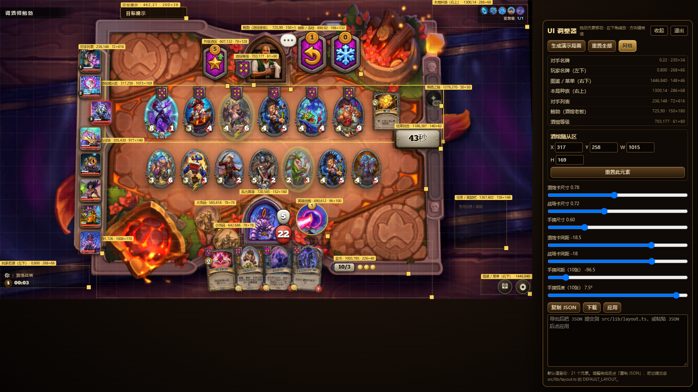


## 更新引擎

引擎是编译好的 `taverngym` 扩展，换版本不需要改前端：

1. 从 AutoTavern 拿到对应 Python 3.10 / Windows x64 的 wheel（或 `pip install .` 自行构建）。
2. 解压替换 `engine/runtime/Lib/site-packages/taverngym/` 与 `taverngym-*.dist-info/`。
3. 重启 `npm run server`，访问 `/api/health` 确认 `game` 版本。
4. 跑 `node scripts/feel-test.mjs` 与 `node scripts/profile-test.mjs` 做冒烟；若新版本改了 `pending` 类型或动作编号，按提示补 UI。

当前使用的引擎：taverngym 1.1.0 / 游戏 37.0.2.256589 / 245 动作 / 2205 张可见卡牌。
