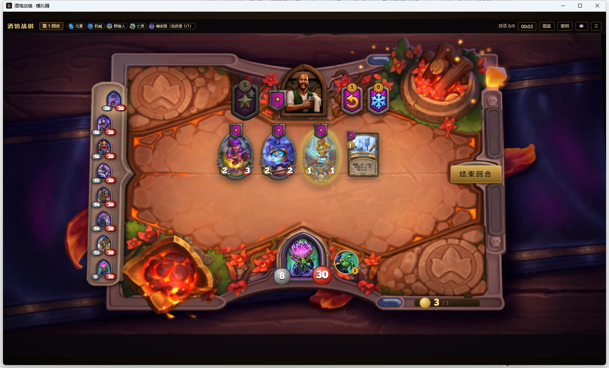

# 桌面版（Tauri）打包

把「React 前端 + 内置 Python 引擎」整个装进一个 Windows 桌面应用里。打包后的程序双击即用：不装 Python、不装 Node、不弹终端窗口、关掉窗口时引擎进程一起退出。



## 怎么做的

原来的运行方式是 `npm run start`：Python 桥（`engine/server.py`）同时**提供 `/api/*` 和静态的 `dist/`**，浏览器访问 `http://127.0.0.1:8787`。桌面版完全沿用这套：

```
bgsim.exe (Tauri/Rust)
  └─ 启动时占用固定端口（8801 → 8802 → 8803，都被占才随机）
     └─ spawn  $RESOURCE/engine/runtime/python.exe  $RESOURCE/engine/server.py --port N
        └─ 该进程既提供 /api/*，也提供 $RESOURCE/dist/
  └─ 窗口导航到 http://127.0.0.1:N/
  └─ 退出时 kill 掉上面的 Python 进程
```

因为页面和 API 同源，前端一行代码都不用改（`fetch('/api/state')` 照旧）。

端口为什么要固定：webview 的源是 `http://127.0.0.1:<端口>`，而 localStorage（布局、音效、限时开关、联机中继地址）是按源隔离的——每次随机端口等于每次换一个「新浏览器」，玩家调过的布局会静默丢失。8787（开发引擎）、8790（联机中继）、8799（测试引擎）都已被占用，所以桌面端用 8801 起。

### 关键实现

`src-tauri/src/lib.rs`：

| 步骤 | 做法 |
| --- | --- |
| 找引擎 | 依次尝试 `resource_dir()/engine`、`<exe>/engine`、`<exe>/resources/engine`、`src-tauri/../engine`（开发时） |
| 选端口 | 依次试 `8801/8802/8803`，全被占才用系统分配的空闲端口 |
| 启动 | `Command` 传 `--port` + `BGSIM_DATA`；`CREATE_NO_WINDOW` 避免闪黑框 |
| 等就绪 | 轮询 `GET /api/health` 直到返回 200（最多 30 秒），**就绪后才建窗口**，不会看到白屏 |
| 退出 | `RunEvent::Exit` 时 `kill()` + `wait()` 子进程 |

`engine/server.py` 只加了一处：存档目录优先取环境变量

```python
DATA = Path(os.environ.get("BGSIM_DATA") or (PROJECT / "data"))
```

因为安装到 `%LOCALAPPDATA%\Programs` 后资源目录是只读的，写不了 `save.json`。现在存档落在 `%APPDATA%\com.bgsim.desktop`。

### 资源打包的坑

`tauri.conf.json` 里必须用**目录**形式，不能用 glob：

```json
"resources": {
  "../engine/": "engine/",
  "../dist/": "dist/"
}
```

如果写成 `"../engine/**/*"`，Tauri 会把所有文件**拍平**到同一个目录（官方 schema 明说 glob 形式不保留目录结构），结果是 `engine/runtime/python.exe` 消失、`dist/assets` 也没了——程序能启动但引擎起不来。这条踩过一次，记在这。

## 联机：安装包要和服务器对上

安装包里的客户端**不带联机服务端**（`server/` 不是打包内容，它单独部署在 VPS 上，见
[../server/README.md](../server/README.md)）。客户端只知道一个 WebSocket 地址，三种来源：

| 来源 | 说明 |
| --- | --- |
| 构建时 `VITE_RELAY_URL` | 打进安装包的默认地址，玩家开箱即用 |
| 游戏内「联机大厅 → 修改」 | 存在 `%APPDATA%` 的 localStorage 里，换服不用重装 |
| 启动参数 `?relay=` | 临时调试用（Tauri 里就是改 URL，一般用不到） |

```powershell
# 打包一个指向自己 VPS 的客户端
$env:VITE_RELAY_URL='wss://bg.example.com/net'
npm run desktop
```

或者不设，让玩家第一次进大厅时自己填（地址会记住）。**公网一定用 `wss://`**：WebView 里从 http 页面连
`ws://` 会被拦，明文传动作流也不合适；服务端那边用 Caddy/nginx 做 TLS，`relay.mjs` 只听 127.0.0.1 即可。

两个和桌面版相关的注意点：

- 页面是 `http://127.0.0.1:<随机端口>/`，`/net` 由本机 Python 引擎托管，**它不代理 WebSocket**，
  所以打包版不能像开发服务器那样用同源 `/net`，必须给绝对地址（内置或玩家填）。
- 桌面版和网页版的协议、引擎构建必须一致才会被服务端凑到同一桌；换引擎（`engine/runtime`）就要
  连客户端一起重新打包，否则老客户端会单独排队（大厅里会提示「另有 N 人在别的版本上排队」）。

## 构建

> 打包前先把引擎运行时放进 `engine/runtime/`（仓库不含它，见 [README 的「引擎运行时」](../README.md)）；`tauri.conf.json` 会把整个 `engine/` 目录打进安装包。

前置：

- Rust stable + MSVC 工具链（`rustup show` 显示 `x86_64-pc-windows-msvc`）
- Visual Studio 2022 Build Tools（C++ 桌面开发）
- WebView2 运行时（Win10/11 自带）
- Node 20+

```bash
npm install
npm run desktop        # = npx tauri build
```

首次会编译 Rust 依赖（约 2 分钟），并自动下载 NSIS 打包器。

产物：

| 文件 | 大小 |
| --- | --- |
| `src-tauri/target/release/bgsim.exe` | 12.2 MB（绿色版，需与旁边的 `engine/`、`dist/` 一起用） |
| `src-tauri/target/release/bundle/nsis/BGSIM_0.1.0_x64-setup.exe` | 24.8 MB（安装包，装到当前用户） |

安装包默认按当前用户安装（不需要管理员），语言为简体中文 / English。

## 开发

- 改 UI：还是 `npm run start`，浏览器里改最快（有 HMR）。
- 改外壳（窗口 / 进程管理）：`npm run build && npm run desktop:dev`。开发模式加载的是**已经构建好的 `dist/`**（不是 Vite dev server），因为窗口指向的是 Python 服务的地址。

## 验证过的

- `bgsim.exe` 双击启动 → 自动拉起 `engine/runtime/python.exe`（端口 8801）→ 首页显示「引擎 1.1.0 · 游戏版本 37.0.2.256589 · 卡牌 2205」，说明健康检查、SPA、CDN 图都正常。
- 窗口按屏幕自适应：按工作区的 92%×94% 开，UI 跟着等比放大。
- 默认布局与「UI 调整器」导出的那套一致（`node scripts/check-layout.mjs` 逐项比对，18 个盒子全中）。
- 点「开始对局」→ 英雄选择 → 选英雄 → 酒馆界面（商店 / 酒馆 / 对手栏 / 结束回合）全部正常。
- 关窗口后：`bgsim.exe` 与 Python 子进程都消失，没有残留（用 `Get-Process` / `Win32_Process` 核对过）。
- 标题栏用 `Theme::Dark`，和深色酒馆界面一致。

## 还没做 / 已知限制

- **没有代码签名**：首次运行 SmartScreen 会提示「未知发布者」，需要点「更多信息 → 仍要运行」。要消掉得买证书。
- **没做自动更新**（`tauri-plugin-updater`），现在升级只能重装。
- **没做单实例限制**：双击两次会起两个进程；第二个拿不到 8801，会退到 8802（两个进程互不干扰，但会各开一局）。
- 窗口默认按屏幕工作区的 92%×94% 开（1600×940 为下限，2400×1400 为上限），不记忆上次大小。
- 安装包没带 `dist` 之外的 CDN 缓存：卡图仍走 `art.hearthstonejson.com`，离线时只有本地 `public/img` 的那部分能显示。
- 联机服务器地址存在 WebView 的 localStorage 里（`%APPDATA%\com.bgsim.desktop`），不写在注册表；换机器要重填。
